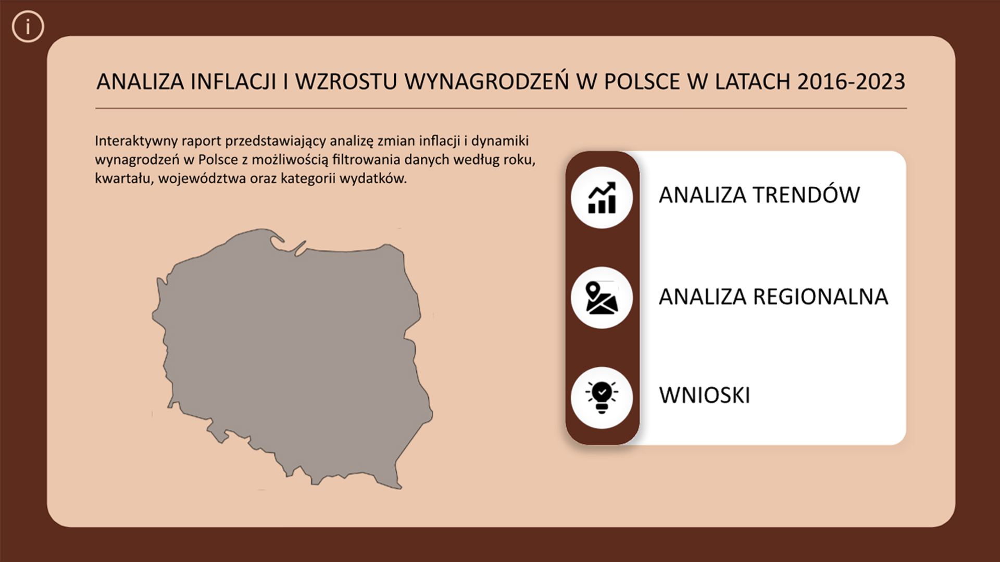
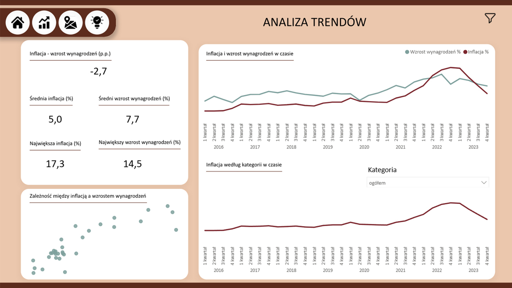
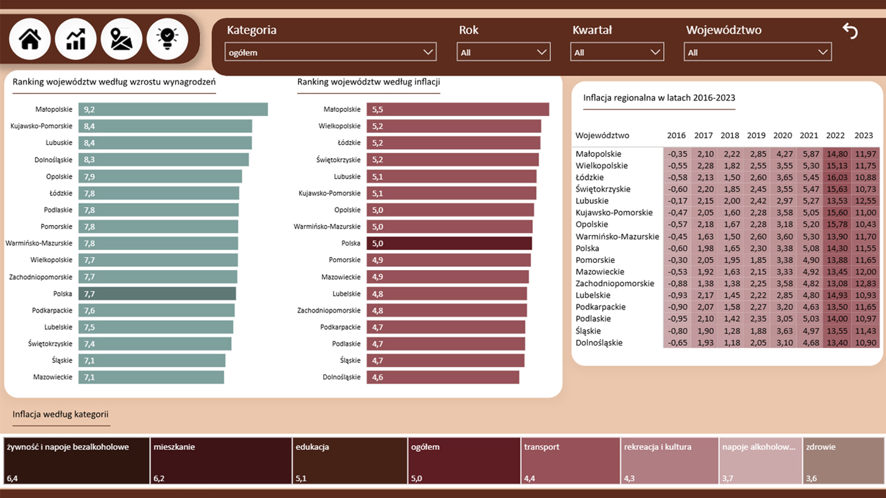

# Analiza inflacji i wzrostu wynagrodzeń w Polsce (2016–2023)
Interaktywny raport Power BI analizujący zmiany inflacji oraz dynamiki przeciętnych wynagrodzeń w Polsce w latach 2016–2023, z uwzględnieniem różnic regionalnych i kategorii produktów i usług.

## Interactive Dashboard

[**View Interactive Power BI Report**](https://app.powerbi.com/view?r=eyJrIjoiOTAyYjFjZDUtNTU2Ny00ZjkxLWJjMGYtNDk1MWMwNDkxNjk1IiwidCI6IjNkZmU5YWI2LTgxYmYtNDkxYy1iNjcwLTAxYzgyNGEwOWUxOSJ9)

## Goal 
Zbadanie zmian inflacji i wzrostu wynagrodzeń w czasie, porównanie obu wskaźników oraz identyfikacja różnic regionalnych i kategorii, w których odnotowano największe zmiany cen.

## Tools
Power BI · Power Query · DAX · M · Excel

## Model
Star Schema 

## Data Preparation
-	Import i przekształcanie wielu plików Excel w Power Query
-	Czyszczenie i ujednolicanie danych oraz zmiana typów danych
-	Przekształcanie struktury tabel i uzupełnianie brakujących nagłówków kwartałów z wykorzystaniem języka M
-	Przeliczenie wskaźników dynamiki wynagrodzeń do postaci procentowej
-	Utworzenie kolumny roku na podstawie nazw plików źródłowych
-	Przygotowanie tabel wymiarów daty i województw
-	Utworzenie miar DAX do analizy inflacji, wzrostu wynagrodzeń i różnic między wskaźnikami

## Visuals
KPI Cards · Line Chart · Scatter Plot · Bar Charts · Matrix · Treemap · Slicery

## Key insight
-	W latach 2021–2023 nastąpił wyraźny wzrost inflacji, a w kolejnych kwartałach inflacja przewyższała tempo wzrostu wynagrodzeń.
-	Największa średnia różnica między inflacją a wzrostem wynagrodzeń wystąpiła w 2018 r. i wyniosła 5,84 p.p., a najmniejsza w 2023 r. - 0,65 p.p.
-	Zaobserwowano różnice regionalne w poziomie inflacji i dynamice wynagrodzeń.
-	Największe zmiany cen dotyczyły m.in. żywności i napojów bezalkoholowych, mieszkań, edukacji oraz transportu.

[View Full Documentation (PDF)](README.pdf)

## Dashboard Preview

### Strona Główna

### Analiza Trendów

### Analiza Regionalna

